<p align="center">
  
</p>

<h1 align="center">Sketchy</h1>

<p align="center">
  A calm drawing space on iPad. Pick how you feel, put on a relaxing sound, and draw.<br>
  No rules, no pressure. Just you and the page.
</p>

<p align="center">
  
  
  
</p>

---

## About

Sketchy is an iPad app for designers and artists dealing with art block.

When you're stuck, a blank canvas can feel overwhelming: what should I draw, which colors should I use? Sketchy takes that pressure away. Pick your mood, and the app gives you a clear drawing idea and a matching color palette, so you can stop overthinking and start creating.

If a set idea feels limiting or stressful, **Free draw** gives you an open canvas with no rules.

Relaxing sounds, breathing breaks, and a short reflection keep the whole experience calm.

## What makes Sketchy different

- **Drawing ideas made for your mood, fully offline.** Ideas are written on the device by Apple's own language model (Foundation Models). Nothing is sent to the internet, and the app still works without Apple Intelligence by using written ideas.
- **Colors that match the idea.** Each idea comes with 4 suggested colors, and the full color picker is one tap away.
- **Relaxing sounds that stay with you.** The sound you choose keeps playing while you draw, and you can mute it at any time.
- **Built-in breaks.** After 20 minutes of drawing, a break card offers a guided Deep Breath session, and your drawing is kept while you rest.
- **Reflection, not just drawing.** Two short questions help the user notice what the drawing expresses.
- **A gallery that feels personal.** Every drawing is saved with its name and the user's own signature, and the card flips to show the reflection on the back.
- **A gentle streak.** A flame on Home counts the days in a row you drew, and one missed day is forgiven.
- **Made for Apple Pencil.** Pressure and tilt work out of the box, and a double-tap on the Pencil switches between the brush and the eraser.

## Screenshots

| Welcome | Home | Card back |
|:---:|:---:|:---:|
| 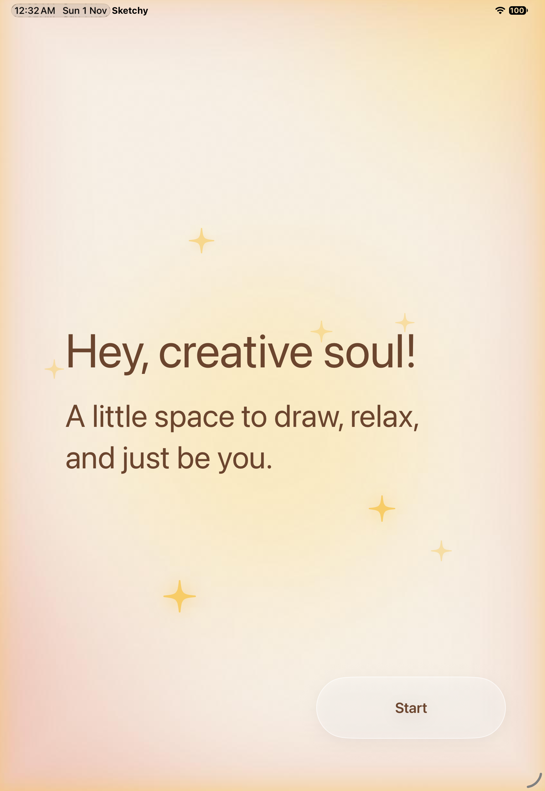 | 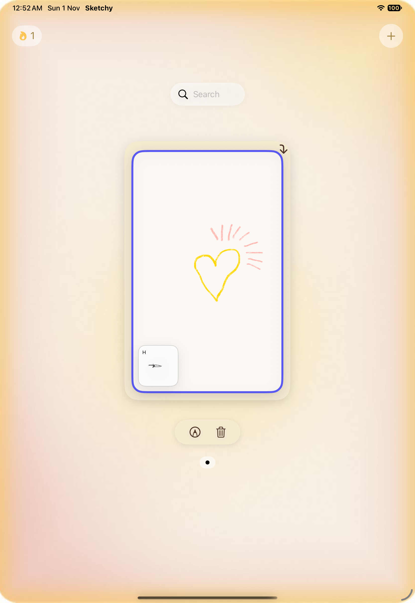 | 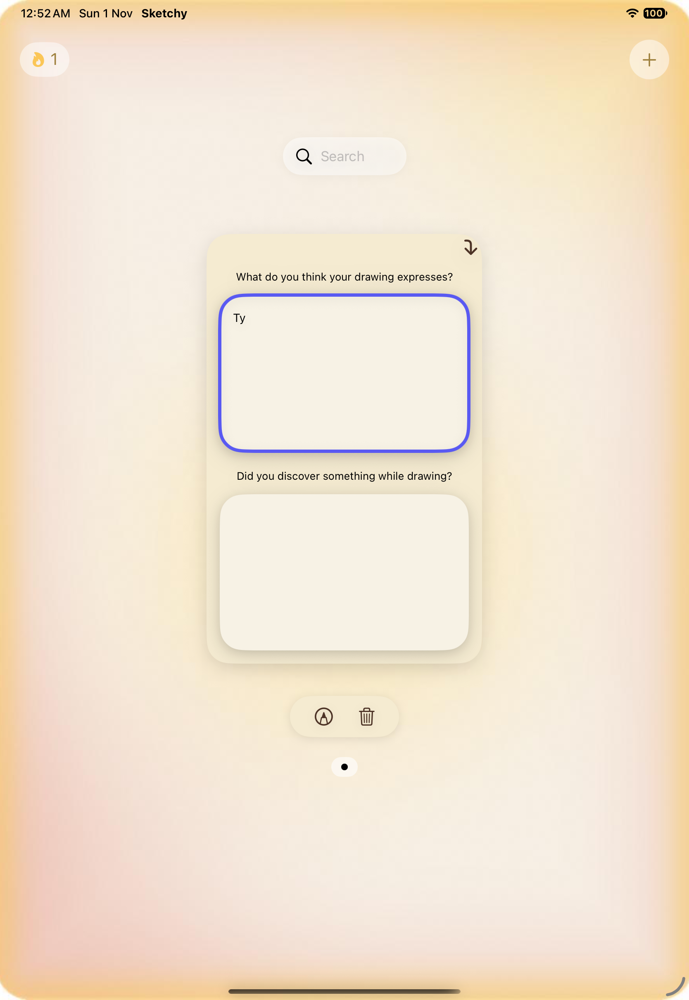 |

| Mood & Sound | Drawing | AI drawing idea |
|:---:|:---:|:---:|
| 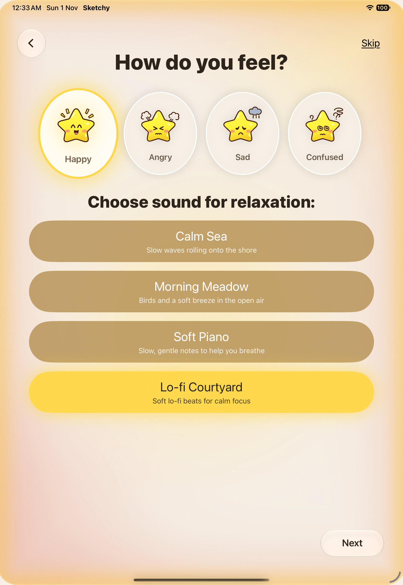 | 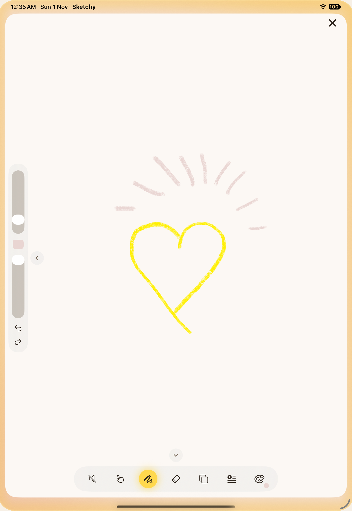 | 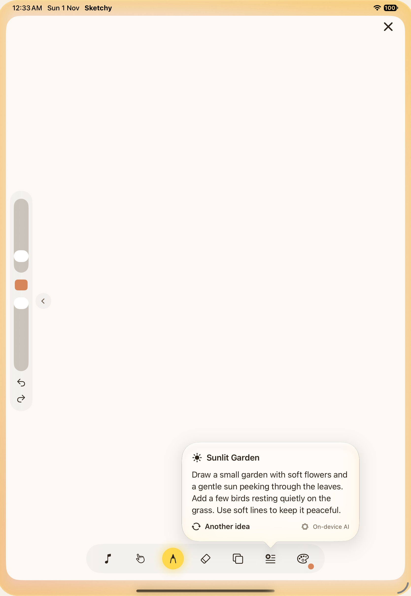 |

| Break | Deep Breath | Reflection |
|:---:|:---:|:---:|
| 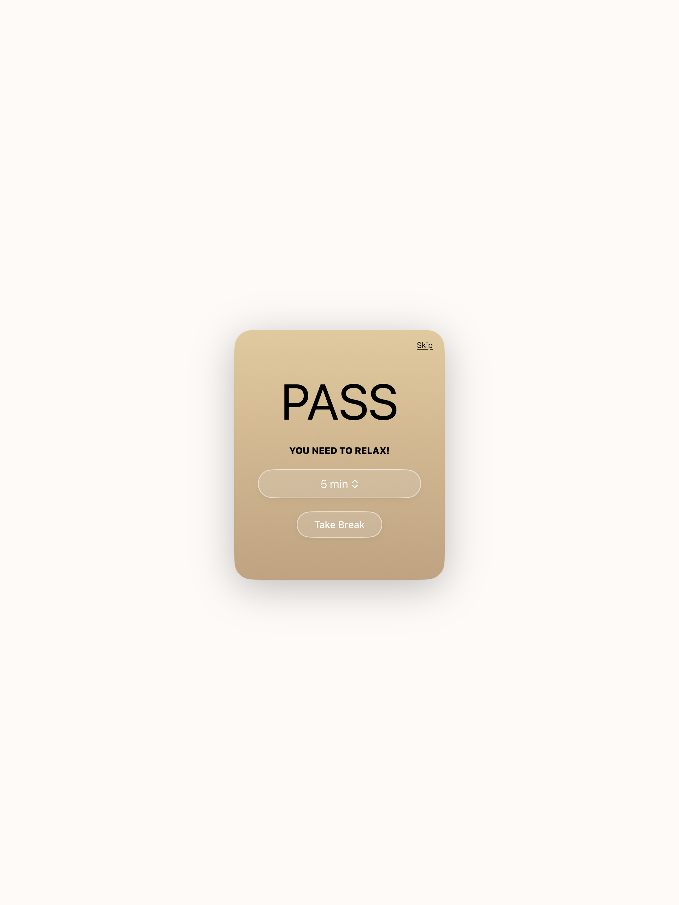 | 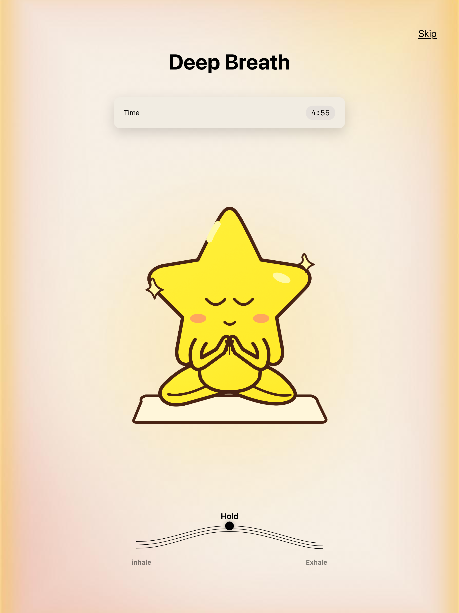 | 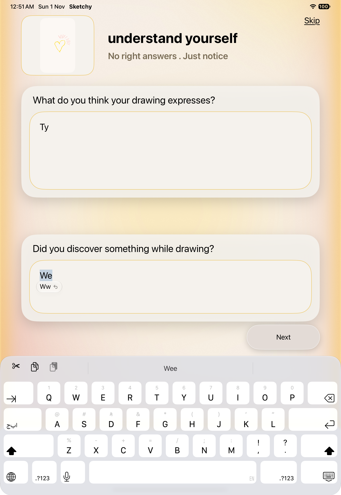 |

| Name & Signature | Celebration |
|:---:|:---:|
| 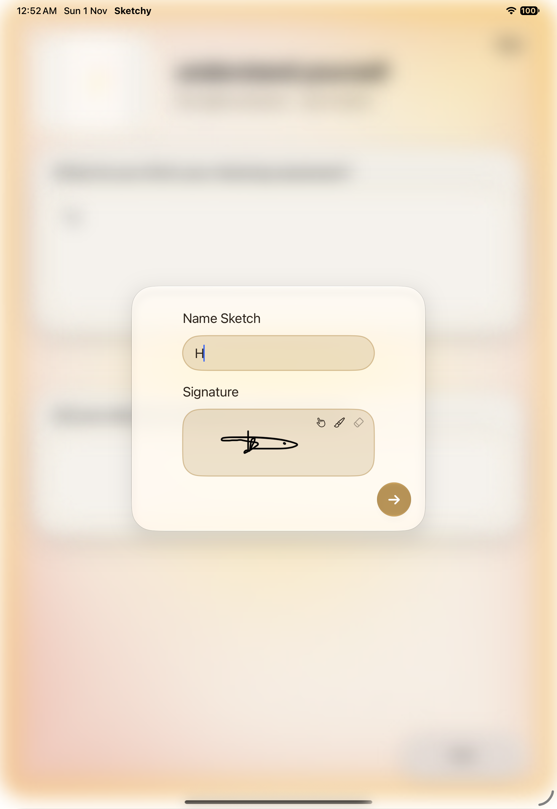 | 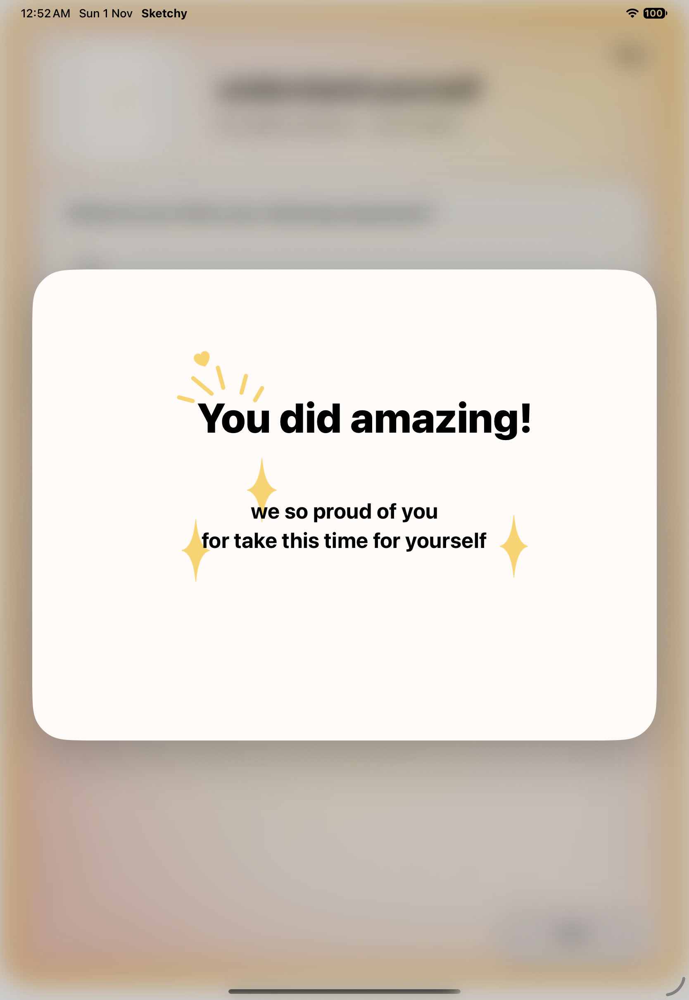 |

## User flow

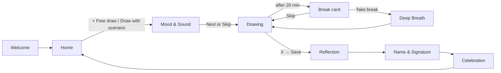

## Features

### Welcome
A short greeting with softly pulsing stars. Tapping **Start** opens Home.

### Home (gallery)
- Carousel of saved drawings, newest first, with search by name.
- Each card shows the drawing with its name and signature. Tap the corner arrow to flip it and read or edit the reflection answers.
- Edit or delete the selected drawing.
- Streak flame at the top that gets darker as the streak grows.
- The **+** button opens two choices: **Free draw** or **Draw with scenario**.

### Mood & Sound
- Choose one of four moods: Happy, Angry, Sad, Confused.
- Choose a relaxing sound: Calm Sea, Morning Meadow, Soft Piano, Lo-fi Courtyard. It starts playing right away so the user can hear it before deciding.
- **Skip** goes straight to the canvas after a confirmation.

### Drawing
- PencilKit canvas with 7 brush types (Pen, Pencil, Marker, Charcoal, Watercolor, Calligraphy, Fine liner), an eraser, and a move tool.
- Sliders for brush size and opacity, plus undo and redo.
- Up to two pages per drawing.
- The drawing idea for the chosen mood opens automatically, with **Another idea** to get a new one.
- Suggested colors for the current idea, plus Apple's full color picker.
- Mute button for the background sound.

### Break and Deep Breath
- After 20 minutes, a **PASS** card asks the user to take a break and choose its length.
- **Deep Breath** guides the user through breathing in, holding, and breathing out, with a timer and an animated wave.

### Finishing a drawing
- **Reflection:** "What do you think your drawing expresses?" and "Did you discover something while drawing?"
- **Name & Signature:** name the drawing and sign it with the Pencil or a finger.
- **Celebration:** a short "You did amazing!" message, then back to Home.

## Code structure

The Xcode project uses folder-based groups, so the folders below are exactly what you see in Xcode.

```
Drow App/
├── Drow App.xcodeproj
└── Drow App/
    ├── App/
    │   └── MyApp.swift               App entry: Welcome first, then Home; sets up SwiftData
    ├── Screens/
    │   ├── Welcome/
    │   │   └── WelcomeView.swift     Greeting page with pulsing stars and the Start button
    │   ├── Home/
    │   │   └── HomeView.swift        Gallery carousel, search, streak, + menu, edit and delete
    │   ├── Mood/
    │   │   └── MoodView.swift        Mood stars, sound buttons, Next and Skip
    │   ├── Drawing/
    │   │   ├── DrawingView.swift     Canvas page: tools, pages, idea card, colors, break timer
    │   │   └── CanvasView.swift      PencilKit canvas and Apple's color picker for SwiftUI
    │   ├── Break/
    │   │   ├── BreakFlowView.swift   Shows the break card, then Deep Breath, over the canvas
    │   │   ├── BreakCardView.swift   The PASS card where the user picks a break length
    │   │   └── DeepBreathView.swift  Guided breathing with a timer and wave animation
    │   └── Finish/
    │       ├── ReflectionView.swift      The two reflection questions; saves the drawing
    │       ├── NameSignatureView.swift   Name field and signature pad
    │       └── CelebrationView.swift     "You did amazing!" card
    ├── Components/
    │   └── GlassConfirmDialog.swift  Reusable Yes / No dialog in Liquid Glass style
    ├── Models/
    │   ├── Models.swift              Mood, Scenario, Sound, DrawTool, InkType
    │   ├── SavedDrawing.swift        SwiftData model for a finished drawing
    │   └── Streak.swift              Stores drawing days and counts the streak
    ├── Services/
    │   ├── ScenarioGenerator.swift   On-device AI ideas, with written ideas as a fallback
    │   └── SoundPlayer.swift         Plays one looping sound across the app
    ├── Theme/
    │   └── Theme.swift               App colors and the aura background
    ├── Resources/
    │   └── Sounds/                   sea, morning, piano, music (.mp3)
    └── Assets.xcassets               App icon, mood stars, backgrounds
```

### How the parts work together

| Part | How it works |
|---|---|
| **Navigation** | `MyApp` shows `WelcomeView`, then a `NavigationStack` with `HomeView`. Home pushes `MoodView`, which pushes `DrawingView`. Breaks and the finishing pages open as full-screen covers, so the drawing stays in memory. |
| **Saving** | `SavedDrawing` is a SwiftData `@Model`. It keeps the image, the signature, the reflection answers, and the PencilKit strokes of each page, so a drawing can be opened and edited later. Home reads it with `@Query`. |
| **AI ideas** | `ScenarioGenerator` checks `SystemLanguageModel.default.availability`. If the model is available, it asks for 3 ideas at once using a `@Generable` struct (title, text, 4 colors). If not, it uses the ideas written in `Models.swift`. |
| **Sound** | `SoundPlayer.shared` is one `AVAudioPlayer` that loops forever (`numberOfLoops = -1`). Each sound has its own volume so they sound equally loud. |
| **Streak** | Drawing days are kept in `@AppStorage`, separate from the drawings, so deleting a drawing does not break the streak. |

## Built with

- **SwiftUI**: all screens
- **PencilKit**: drawing canvas and signature pad
- **SwiftData**: saving drawings on the device
- **Foundation Models**: on-device AI drawing ideas
- **AVFoundation**: background sounds
- **UIKit**: `UIColorPickerViewController`, wrapped for SwiftUI

## Requirements

- Xcode 26 or later
- iPad with iPadOS 26 or later
- Apple Pencil is recommended; drawing with a finger also works
- For AI ideas: an iPad that supports Apple Intelligence, with it turned on. Without it, the app uses its written ideas.

## Getting started

```bash
git clone https://github.com/HatunMQ/challenge-1.git
cd challenge-1
open "Drow App/Drow App.xcodeproj"
```

Choose an iPad simulator or device, then press **Run** (⌘R).


